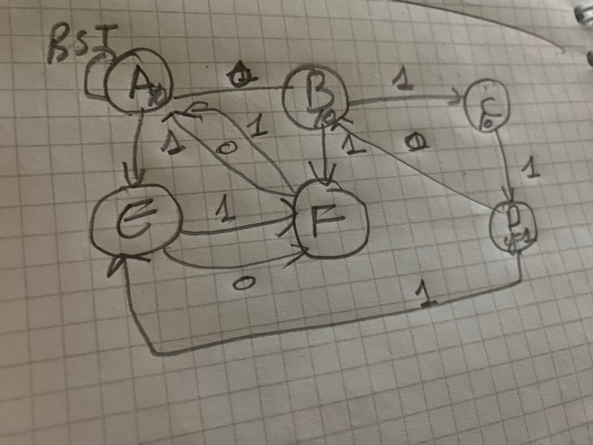
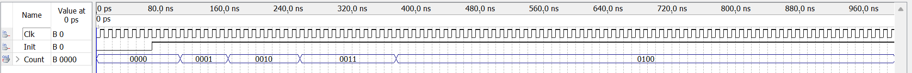
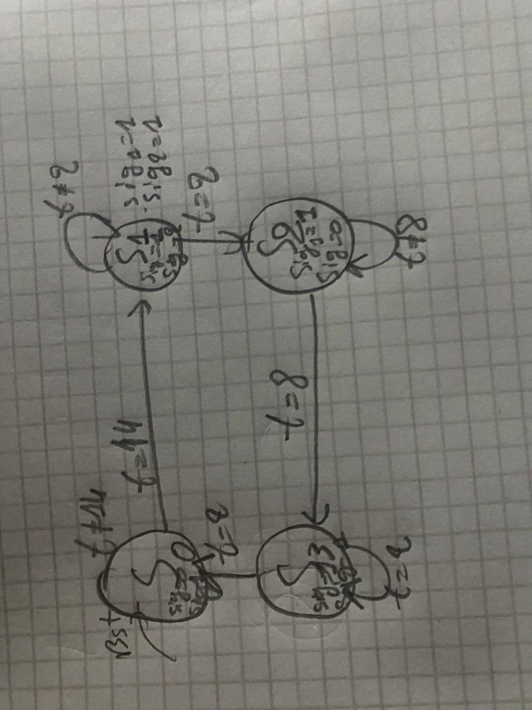
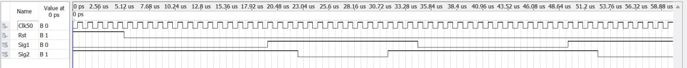

# FSM Applications in VHDL (Altera DE2 / Cyclone II)

Design, simulation and implementation of Moore finite-state machines in behavioral VHDL.
Lab work #4 of EE-421 (UMBB / IGEE, M1 Computer Engineering). Targeted at the Altera DE2 board
(Cyclone II EP2C35F672C6), developed with Quartus II and ModelSim.

| Design | What it does | Key concepts |
|---|---|---|
| [`octal_counter.vhd`](src/octal_counter.vhd) | Counts how many of ten octal digits in a 30-bit serial stream equal 3 | PISO shift register, Moore detector aligned on 3-bit boundaries, mod-16 counter |
| [`wave_gen.vhd`](src/wave_gen.vhd) | Generates the two drive signals of an inverter leg, 30 µs period, with 3 µs dead times | Clock divider (50 MHz → 1 MHz), timer-based Moore FSM |

## 1. Octal digit counter

**Architecture:** a 30-bit parallel-in/serial-out register (10 octal digits, MSB first) feeds a Moore FSM
that raises `z` when the digit `011` (octal 3) has just been received. A mod-16 counter increments on each
detection. A common active-low `Init` loads the register and resets the FSM and counter.



The FSM tracks position inside each 3-bit digit (states `A`/`D` = digit start, `B`/`C` = matching so far,
`E`/`F` = mismatch, skip to the digit boundary), so `011` is never falsely matched across two digits.

**Result:** the test word is `3 7 3 0 5 3 6 7 2 3` (octal). Digits 1, 3, 6 and 10 equal 3, so the counter
ends at **4** (`0100`).



## 2. Waveform generator

**Architecture:** a divide-by-50 counter turns the 50 MHz board clock into a 1 µs clock. A four-state Moore FSM
uses a per-state timer `t` to hold each state for a whole number of 1 µs periods.

| State | Sig1 | Sig2 | Duration | Timer ends at |
|---|---|---|---|---|
| S0 | 0 | 1 | 15 µs | t = 14 |
| S1 (dead time) | 1 | 1 | 3 µs | t = 2 |
| S2 | 1 | 0 | 9 µs | t = 8 |
| S3 (dead time) | 1 | 1 | 3 µs | t = 2 |




## Simulation

Self-checking testbenches are in [`sim/`](sim). With [GHDL](https://github.com/ghdl/ghdl):

```bash
ghdl -a --std=08 src/octal_counter.vhd sim/tb_octal_counter.vhd
ghdl -r --std=08 tb_octal_counter      # PASS: Count = 4

ghdl -a --std=08 src/wave_gen.vhd sim/tb_wave_gen.vhd
ghdl -r --std=08 tb_wave_gen           # Sig1 low = 15 us, Sig2 low = 9 us, PASS
```

## Design notes

- **Moore outputs:** outputs depend only on the state, so they are glitch-free and synchronous, at the cost of
  one extra clock of detection latency compared with a Mealy machine.
- **Timer-based states:** a counter inside each state keeps the state diagram at four states instead of one
  state per clock cycle.
- **Dead time:** the two 3 µs intervals with both signals high keep both devices of the leg off (assuming an
  active-low gate drive), so they never conduct together.

## Repository layout

```
src/    VHDL sources
sim/    self-checking testbenches
docs/   original lab report (PDF) and figures
```

## Author

<Your name> — <LinkedIn / email>
